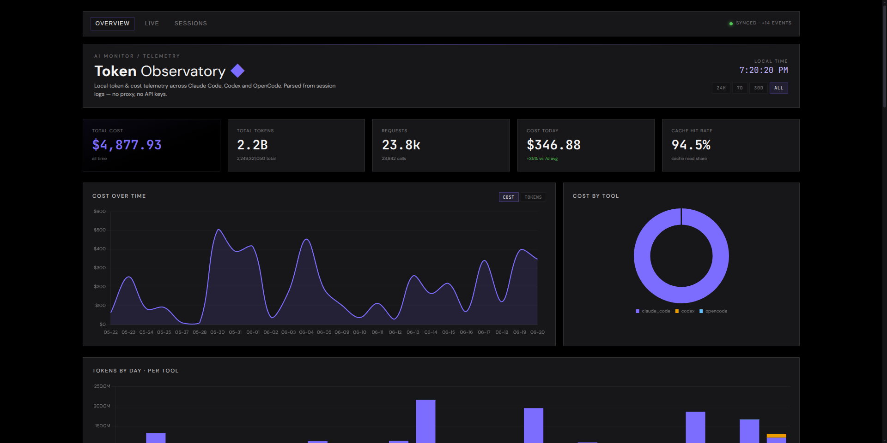
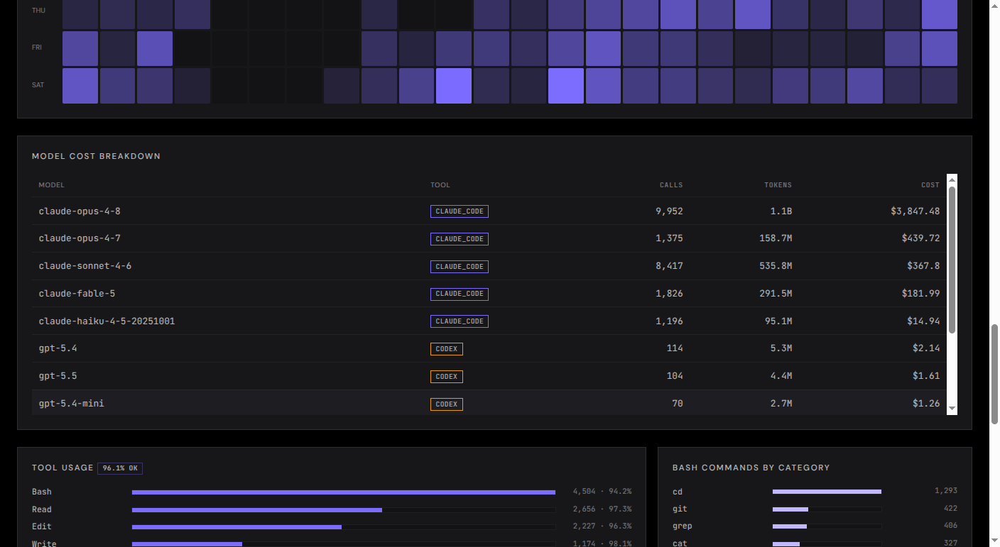
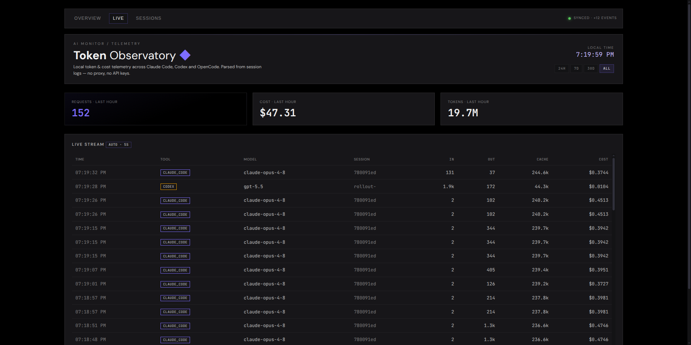
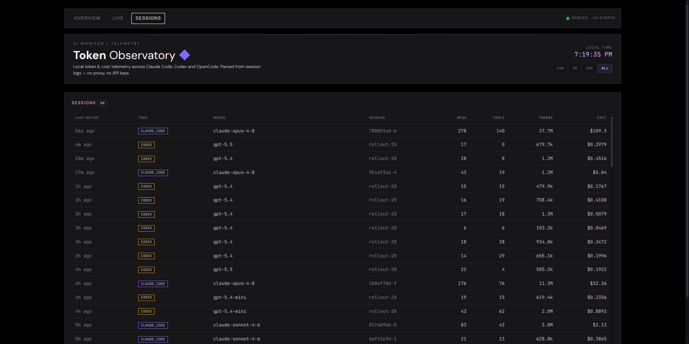

<h1 align="center">AI Usage Monitor</h1>

<p align="center">
  Token and cost tracking for Claude Code, Codex and OpenCode.<br />
  It reads the session logs you already have and shows the totals in a local dashboard.
</p>

<p align="center">
  <a href="#installation">Install</a>
  ·
  <a href="#configuration">Configuration</a>
  ·
  <a href="#http-api">HTTP API</a>
</p>

<p align="center">
  
</p>

AI Usage Monitor shows how many tokens each tool uses and what those calls cost, as an estimate. It reads the session logs that Claude Code, Codex and OpenCode already write on your machine, prices every model call, and stores the results in SQLite. Open the dashboard at http://127.0.0.1:8787 to see them.

No proxy sits between you and the providers, and no API key is needed. A background thread scans the logs every 60 seconds, and a FastAPI server serves the dashboard and a JSON API from the same process. You need Linux and Python 3.10 or newer.

## What you get

- **Estimated cost for every model call.** The collectors parse Claude Code JSONL files, Codex rollout files and OpenCode's SQLite database. Each call is priced from the rates in `monitor/pricing.py`. Models without a rate count as $0.
- **Only new log lines are read.** The monitor stores a byte offset for each JSONL file, so each poll reads what was appended since the last one. Every event has a stable ID, and inserts use `INSERT OR IGNORE`, so a repeated poll adds nothing twice.
- **Three dashboard views.** Overview covers totals and trends. Live covers the last hour. Sessions covers the requests, tokens and cost of each session.
- **Success rates by tool.** Claude Code tool results keep their error flag, so the Overview reports a success rate for each tool. Codex calls carry no error flag, so the collector counts all of them as successful.
- **Lines changed by file type.** Claude Code edit results include a structured patch. The collector counts added and removed lines from it and groups them by file extension.
- **Local data.** The database is a SQLite file in the project folder by default, and the server listens on `127.0.0.1`. It holds token counts, models, session IDs, tool names, file paths and the first word of each Bash command. It holds no prompts or responses.
- **An optional Obsidian note.** Each poll rewrites today's note in your vault with the day's cost and token totals, broken down by tool.

## Installation

Installation runs on Linux with systemd user services. Clone the repository to `~/Anuraj-Dev/ai-usage-monitor`. The bundled unit file hardcodes that path, so the service fails to start from anywhere else.

| Method | What it does |
| --- | --- |
| Installer | Creates `.venv`, installs the dependencies, imports existing logs, and enables the systemd service. |
| Manual | Runs the monitor in your terminal, without systemd. |

### Installer

```sh
mkdir -p ~/Anuraj-Dev
git clone https://github.com/Anuraj-dev/ai-usage-monitor.git ~/Anuraj-Dev/ai-usage-monitor
cd ~/Anuraj-Dev/ai-usage-monitor
./install.sh
```

The script copies the unit file to `~/.config/systemd/user/`, enables it, and tries to turn on lingering, so the service keeps running after you log out. When it finishes, open http://127.0.0.1:8787.

### Manual

```sh
python3 -m venv .venv
.venv/bin/pip install -r requirements.txt
.venv/bin/python -m monitor.backfill   # import existing history
.venv/bin/python -m monitor.server     # start the dashboard
```

Run these from the project folder. The server stays in the foreground. Stop the service first with `systemctl --user stop ai-usage-monitor` if it is running, because both use port 8787.

## Supported tools

| Tool | Local source | What the monitor reads |
| --- | --- | --- |
| Claude Code | `~/.claude/projects/**/*.jsonl` | Token usage per assistant message, tool calls, and line counts from edit results |
| Codex | `~/.codex/sessions/**/rollout-*.jsonl` | Token usage from `token_count` events, and shell and function calls |
| OpenCode | `~/.local/share/opencode/opencode.db` | Token usage and reported cost per assistant message, opened read-only |

Costs are estimates. `monitor/pricing.py` lists USD rates per million tokens for input, output, cache writes and cache reads. The monitor matches each rate to the model name by substring, and the longest match wins. OpenCode uses the cost it reports when one is present. Each event keeps the cost it had when it was first collected, so a rate change applies only to events collected after the change. Review the rates as provider prices change.

## Dashboard

The dashboard runs at http://127.0.0.1:8787. The 24H, 7D and 30D buttons in the header limit the Overview totals and tables to that window. ALL shows everything.

- Overview: totals, daily cost and token charts, lines changed by file type, the activity heatmap, the model cost table, tool usage and the most-used Bash commands.
- Live: requests, cost and tokens for the last hour, plus a stream of the 60 newest events. The stream refreshes every five seconds while the tab is visible.
- Sessions: the 80 most recent sessions, with last activity, tool, most-used model, requests, tool calls, tokens and cost.

The Monthly Forecast card shows the spend over the last 30 days.

<p align="center">
  
</p>

<p align="center">
  
</p>

<p align="center">
  
</p>

## Configuration

Set these variables in your shell for manual runs. The defaults apply when a variable is unset.

| Variable | Purpose | Default |
| --- | --- | --- |
| `AIUM_HOST` | Address the server binds to | `127.0.0.1` |
| `AIUM_PORT` | Dashboard port | `8787` |
| `AIUM_POLL` | Seconds between log scans | `60` |
| `AIUM_DB` | SQLite database path | `usage.db` in the project folder |
| `AIUM_VAULT` | Obsidian vault folder | The path set in `monitor/config.py` |
| `AIUM_VAULT_OFF` | Set to `1` to stop writing vault notes | Unset |

If the vault folder does not exist, the monitor creates the missing folders, including the vault folder itself. The daily notes go in an `AI Usage` folder inside the vault, one file per day named `YYYY-MM-DD.md`.

### Changing service settings

The installer copies the unit file to `~/.config/systemd/user/`, so editing the repository copy has no effect. Add overrides with a drop-in:

```sh
systemctl --user edit ai-usage-monitor
```

Put this in the editor that opens.

```ini
[Service]
Environment=AIUM_PORT=9000
```

Restart the service to apply it. Then open the dashboard on the new port.

```sh
systemctl --user restart ai-usage-monitor
```

## Service management

```sh
systemctl --user status ai-usage-monitor
systemctl --user restart ai-usage-monitor
systemctl --user stop ai-usage-monitor
journalctl --user -u ai-usage-monitor -f
```

When a poll finds new events, the journal logs a line such as `[poll] +14 new events`.

## HTTP API

| Endpoint | Description |
| --- | --- |
| `GET /api/stats` | Overview metrics. Accepts `?days=N` to limit the window. Also reports the last poll time and any collection error. |
| `GET /api/live` | Last-hour counters and the 60 newest events. |
| `GET /api/sessions` | Session summaries, newest first. Accepts `?limit=N`, default 80. |
| `POST /api/refresh` | Runs a collection pass now and returns the number of rows added. |
| `GET /health` | Liveness check. Returns `{"ok": true}`. |

The API has no authentication. Keep `AIUM_HOST` on `127.0.0.1` unless you trust every machine that can reach the port.

## How it works

A background thread runs a poll every `AIUM_POLL` seconds. Each poll parses new lines from every log source, turns them into events and tool calls, and writes them to SQLite with `INSERT OR IGNORE`. JSONL files are tracked by byte offset. The monitor remembers the newest OpenCode message timestamp it has seen, reads only newer rows, and opens that database read-only. The same process serves the dashboard and the API.

The dashboard loads Chart.js from jsDelivr and fonts from Google Fonts, so the page needs internet access for those two. Your usage data stays on the machine.

## Acknowledgements

The dashboard design is adapted from [agentObservatory](https://github.com/Snehit70/agentObservatory).

## License

MIT. See [LICENSE](LICENSE).
