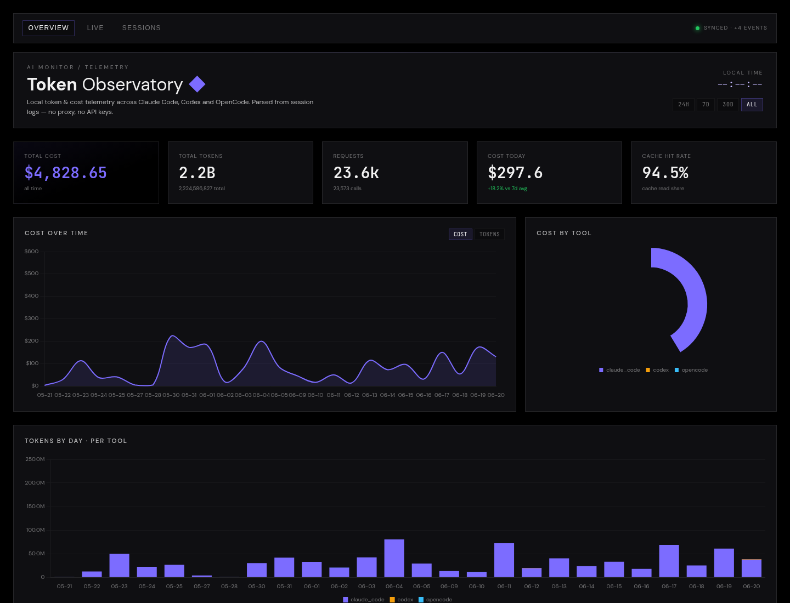

# AI Usage Monitor

AI Usage Monitor is a local dashboard for tracking token consumption and estimated cost across Claude Code, Codex, and OpenCode. It reads each tool's local session data, stores normalized usage events in SQLite, and presents them through a browser-based dashboard.

No proxy or provider API key is required.



## Features

- Usage and estimated cost by tool and model
- Daily token and cost trends
- Cache hit rate, request totals, and monthly projections
- Live event stream with automatic refresh
- Per-session usage breakdowns
- Activity heatmap and command statistics
- Incremental collection with event deduplication
- Optional daily summaries written to an Obsidian vault

## Supported data sources

| Tool | Local source |
| --- | --- |
| Claude Code | `~/.claude/projects/**/*.jsonl` |
| Codex | `~/.codex/sessions/**/rollout-*.jsonl` |
| OpenCode | `~/.local/share/opencode/opencode.db` |

Pricing is defined in `monitor/pricing.py` and should be reviewed periodically as provider pricing changes.

## Requirements

- Linux
- Python 3
- systemd user services for the standard installation

## Installation

```bash
git clone https://github.com/Anuraj-Dev/ai-usage-monitor.git
cd ai-usage-monitor
./install.sh
```

The installer creates a virtual environment, installs the Python dependencies, imports existing usage history, and starts the user service. Open [http://127.0.0.1:8787](http://127.0.0.1:8787) after installation.

## Manual use

```bash
python3 -m venv .venv
.venv/bin/pip install -r requirements.txt
.venv/bin/python -m monitor.backfill
.venv/bin/python -m monitor.server
```

## Service management

```bash
systemctl --user status ai-usage-monitor
systemctl --user restart ai-usage-monitor
journalctl --user -u ai-usage-monitor -f
```

## Configuration

The service accepts the following environment variables:

| Variable | Purpose | Default |
| --- | --- | --- |
| `AIUM_HOST` | Server bind address | `127.0.0.1` |
| `AIUM_PORT` | Dashboard port | `8787` |
| `AIUM_POLL` | Collection interval in seconds | `60` |
| `AIUM_DB` | SQLite database path | `~/ai-usage-monitor/usage.db` |
| `AIUM_VAULT` | Obsidian vault path | Local configured vault |
| `AIUM_VAULT_OFF` | Set to `1` to disable vault summaries | Unset |

Set environment overrides in `ai-usage-monitor.service`, then reload and restart the service:

```bash
systemctl --user daemon-reload
systemctl --user restart ai-usage-monitor
```

## Privacy

All collection and reporting runs locally. The generated SQLite database is excluded from version control because it contains personal usage history.
